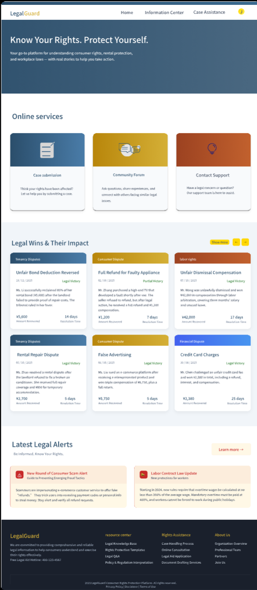

# Product Prototype Projects

User-centred design and accessibility-focused product prototypes.

| Project | What it is | Tools | Highlight |
|---|---|---|---|
| [LegalGuard: Consumer Legal Aid Platform](legal-aid-platform-prototype/) | High-fidelity prototype of a platform that helps consumers understand and resolve consumer-rights issues (group project) | Pixso, Figma | I designed the accessibility mode, home page, login/OTP, forum and news list ([interactive prototype](https://pixso.cn/app/design/qdjXgK437SfpVolAH6HMJA?page-id=0%3A1)) |

The [project README](legal-aid-platform-prototype/) covers the user journey, accessibility design, system flow and my role.
