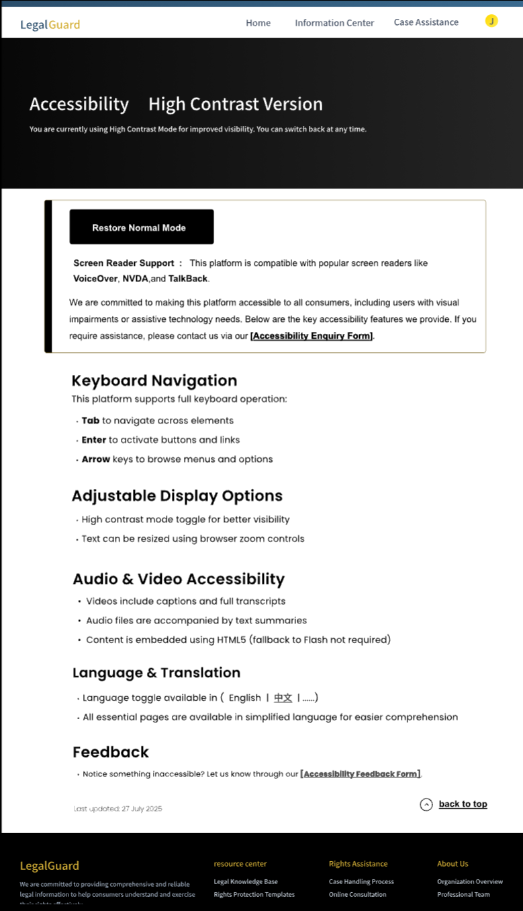
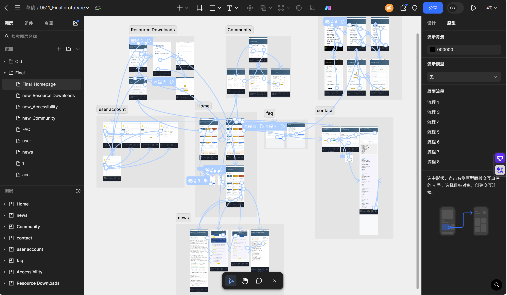

# LegalGuard: Consumer Legal Aid Platform Prototype

A high-fidelity interactive prototype of LegalGuard, a platform that helps consumers work out whether their rights have been breached and what to do about it: read similar cases, ask the community, then submit a case or contact legal support. Accessibility was a core requirement from the start.

**My role:** group project. I designed the accessibility pages (high-contrast mode and assistive-technology support), the home page, login and OTP password recovery, the community forum and the news list. I started the design in Figma and moved it to Pixso when the team switched tools.

**[Open the interactive prototype](https://pixso.cn/app/design/qdjXgK437SfpVolAH6HMJA?page-id=0%3A1)** (Pixso). The source file is [`Final_prototype.pix`](Final_prototype.pix).

  
  
  

## User journey

1. **Sign in.** Username and password login, with OTP-based password recovery.
2. **Home.** Entry points to online services (case submission, community forum, contact support), recent legal wins with amounts recovered, and legal alerts. The top navigation splits into *Information Center* and *Case Assistance*.
3. **Community forum.** Topic sidebar, discussion threads and comments, so users can compare their situation with others before escalating.
4. **FAQ and AI assistant.** Common questions on refunds, complaints and eligibility, plus an AI assistant concept for quick answers.
5. **Case submission.** Form templates for different scenarios with an "Expand All" preview, and two routes: by email or directly on the platform.
6. **Contact legal support.** Legal agencies listed by region with contact details.
7. **News and legal wins.** Separate tabs for legal news and case success stories.
8. **User account.** Viewed posts, case progress tracker, saved topics, notification preferences and personal details.

## Accessibility design

The accessibility pages are designed as a real mode of the product, not a statement page:

- A high-contrast version of the interface with a one-click "Restore Normal Mode"
- Keyboard navigation (Tab, Enter, arrow keys) documented for users
- Screen reader support designed for VoiceOver, NVDA and TalkBack
- Language switching (English / 中文) and simplified-language versions of key pages
- Captions and transcripts for media
- An accessibility feedback form that still works in high-contrast mode

## System flow

The prototype links every page through interaction flows in Pixso:

## Tools

Figma (early design), Pixso (final prototype and interactions).
